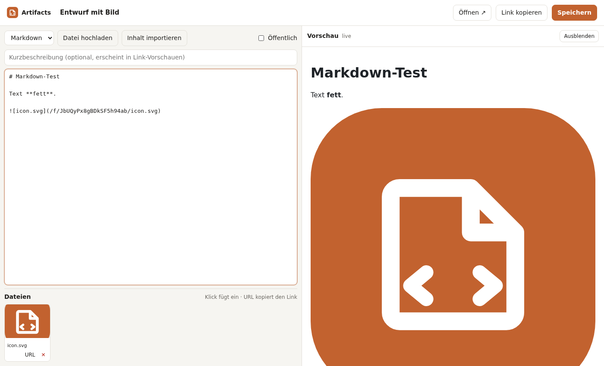

# artifact-share

**Self-hosted sharing for HTML and Markdown artifacts.** Paste a page, or drop in a file. Upload images. Get a link anyone can open.
Think "Claude Artifacts", but on your own server, without the chat.

- **Publish in seconds.** Drag a `.html` or `.md` file onto the dashboard, or write it in the editor with a live preview.
- **Images and files.** Drag & drop or paste screenshots into the editor; they are uploaded and inserted at the cursor.
- **Unguessable links.** Every artifact gets a random 14-character ID (`/a/Xk3…`). There is no public index.
- **Versions.** Every content change is a new version and can be restored.
- **Drafts.** Unpublish an artifact to make its link (and its files) return 404, without deleting anything.
- **API, CLI and tokens.** Named, revocable API tokens with `publish` or `admin` scope, plus a small `bin/artifact` CLI for scripts, CI and AI agents.
- **Persistent app data.** Artifact JavaScript gets a tiny built-in database with private-per-browser and shared namespaces—no backend code required.
- **Sandboxed by design.** Artifact code always runs in an isolated sandbox and can never reach the admin session ([security model](docs/security.md)).
- **Tiny footprint.** One Node.js process, SQLite, one runtime dependency (`marked`). The container idles at about 20 MB of RAM.

<p align="center"></p>

## Quick start

### Docker

```bash
git clone <this repo> artifact-share && cd artifact-share
cp .env.example .env
sed -i "s|^ADMIN_TOKEN=.*|ADMIN_TOKEN=$(openssl rand -base64 32)|" .env
docker compose up -d --build
```

Open <http://127.0.0.1:8790> and log in with the `ADMIN_TOKEN` from `.env`.
For anything beyond a local test, put the app behind HTTPS ([deployment guide](docs/deployment.md)).

### From source

Requires Node.js ≥ 24 (it uses the built-in `node:sqlite`).

```bash
npm ci
ADMIN_TOKEN=$(openssl rand -base64 32) npm start   # http://localhost:3000
```

## Usage

| What | How |
|---|---|
| Create | **+ Neues Artifact**, or drop `.html`/`.md` files onto the list |
| Images | Drag & drop or paste into the editor, or **Datei hochladen** |
| Share | **Link kopieren**. The link is copied automatically on the first save |
| Withdraw | Untick **Öffentlich**: link, raw view and files return 404 |
| Restore | Pick an older version in the **Versionen** dropdown and save |
| Automate | Create a token under **API-Tokens** and use the [API](docs/api.md) or [CLI](docs/cli.md) |
| Store app data | Use `artifactDB.personal` or `artifactDB.shared` from an HTML artifact ([API](docs/api.md#artifact-storage)) |

```bash
export ARTIFACT_SHARE_URL=https://artifacts.example.com ARTIFACT_SHARE_TOKEN=as_…
bin/artifact publish report.md --description "Weekly numbers"
# https://artifacts.example.com/a/Xk3pQ9…   Xk3pQ9…   v1
```

## Documentation

| Document | Contents |
|---|---|
| [docs/configuration.md](docs/configuration.md) | All environment variables |
| [docs/deployment.md](docs/deployment.md) | Docker, Portainer, Traefik, backups, upgrades |
| [docs/api.md](docs/api.md) | REST API reference |
| [docs/cli.md](docs/cli.md) | `bin/artifact` command line client |
| [docs/security.md](docs/security.md) | Threat model and how each threat is handled |
| [docs/development.md](docs/development.md) | Project layout, tests, design decisions |
| [docs/enterprise.md](docs/enterprise.md) | Mastra/MCP architecture and a staged company rollout |
| [SECURITY.md](SECURITY.md) | Reporting vulnerabilities |
| [CONTRIBUTING.md](CONTRIBUTING.md) | How to contribute |
| [CHANGELOG.md](CHANGELOG.md) | Release notes |
| [integrations/openclaw](integrations/openclaw/README.md) | Skill for OpenClaw agents |
| [integrations/mastra](integrations/mastra/README.md) | Native Mastra tools and an optional MCP server adapter |

## How it works

```
Browser ──► /a/<id>      viewer page (title bar + sandboxed iframe), embeddable anywhere
              └─ iframe ► /raw/<id>   artifact HTML + scoped storage client, CSP sandbox (opaque origin)
                            └─ /<name>">   uploaded files, inert (CSP sandbox, nosniff)
                            └─ artifactDB ─► /frame/db/<id>/call ─► SQLite
Admin ─────► /            single-page admin UI (session cookie)
Scripts ───► /api/*       JSON API (Bearer token)
```

Everything lives in one data directory: `artifacts.db` (SQLite: artifacts, versions, files, tokens, sessions and artifact app data) and `files/` (uploads).

## Non-goals

No chat or LLM integration, no comments, no user accounts beyond a single admin plus API tokens, no realtime collaboration. Personal artifact storage identifies a browser profile, not a human account.
The goal is a small, auditable tool that does one thing.

## License

[MIT](LICENSE)
