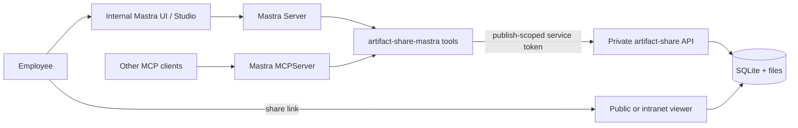

# Mastra and company deployment

artifact-share is an artifact runtime and publishing API, not an identity provider or an agent framework. Keep those responsibilities separate: let Mastra authenticate employees and orchestrate agents, and let artifact-share render, version, and persist artifacts.

## Integration choice

Use the [native Mastra tools](../integrations/mastra/README.md) when artifact-share is called only by agents inside one Mastra application. They are simpler to type, test, trace, and put behind human approval.

Add the `MCPServer` wrapper when multiple MCP-compatible clients need the same tools. Mastra can register that server in the same application, so the tools have one implementation. Mastra documents both [MCP servers](https://mastra.ai/docs/agents/mcp-guide) and the [authentication boundary](https://mastra.ai/docs/guides/mcp-authentication-authorization).

## Security boundary

- Store a dedicated artifact-share `publish` token in the Mastra environment or secret store. Do not use `ADMIN_TOKEN`.
- Never pass the MCP bearer token to artifact-share. The MCP token authenticates the caller to Mastra; the artifact-share token authenticates Mastra to the upstream service.
- Protect all Mastra MCP and REST execution routes. Protecting only `/mcp` or `/sse` leaves inspection or direct-execution endpoints exposed.
- Resolve employee and tenant identity from verified request context, never from tool arguments written by the model.
- Keep write approvals enabled during the pilot. Deletion requires approval by default in the adapter.
- Put the artifact-share admin/API origin on a private network. Expose only viewer, raw artifact, file, health, and frame-storage routes through the public or intranet proxy.

## Current product limits

Version 0.4 has one administrative trust domain. A `publish` token can list and modify every artifact in that instance. It does not provide SSO, RBAC, tenant isolation, audit export, retention policies, or per-user ownership.

Artifact app storage has two intentionally lightweight identities:

- `personal` belongs to a browser profile cookie, not an employee identity.
- `shared` is readable and writable by anyone who can open the artifact link.

Do not use either mode for confidential employee or customer records until authenticated artifact viewers and tenant-aware authorization are implemented. For an initial company rollout, use one artifact-share instance per trust boundary or team.

## Staged rollout

1. **Pilot:** private artifact-share instance, dedicated `publish` token, native Mastra tools, approval on every write, non-sensitive content only.
2. **Operationalize:** backups, restore drill, monitoring, rate limits, log retention, image pinning, vulnerability scanning, and token rotation.
3. **Broaden:** register the MCP wrapper for additional approved clients and add centralized Mastra authentication/authorization.
4. **Multi-team:** add SSO/RBAC and tenant scoping to artifact-share, or keep isolated instances per team.
5. **Sensitive data:** complete threat modeling, data classification, retention/deletion controls, audit trails, and a security review before enabling it.
